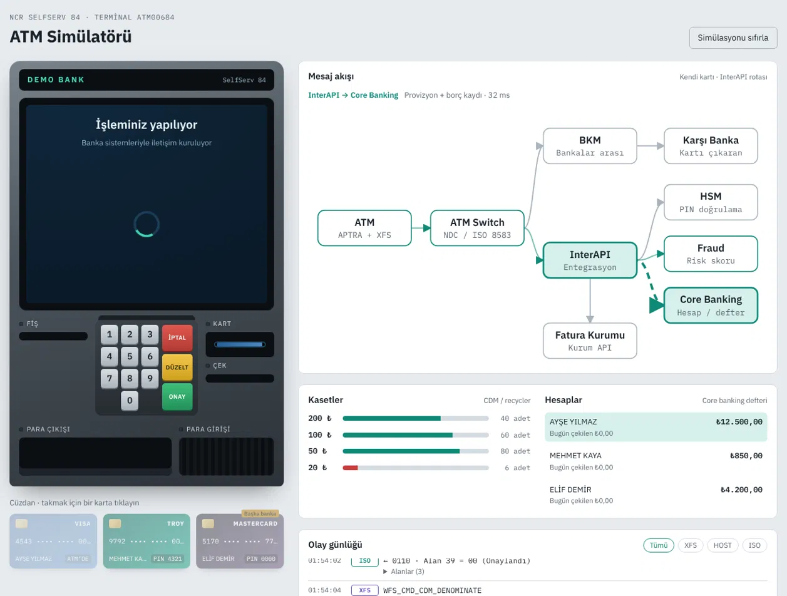
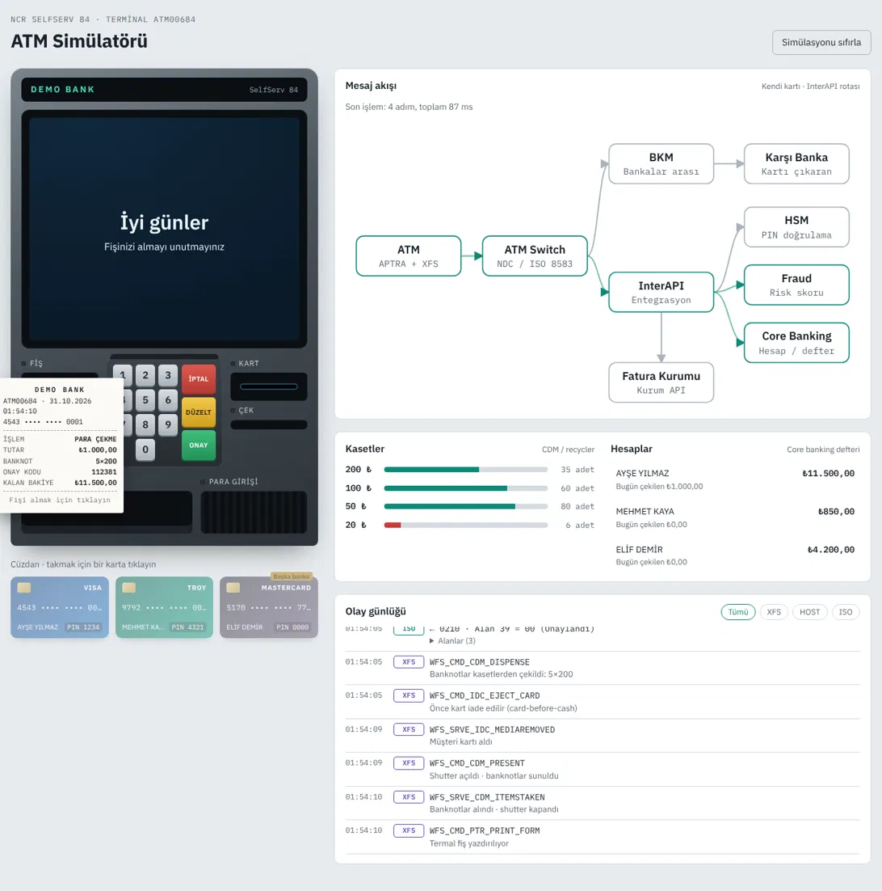
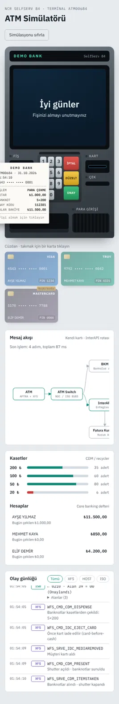
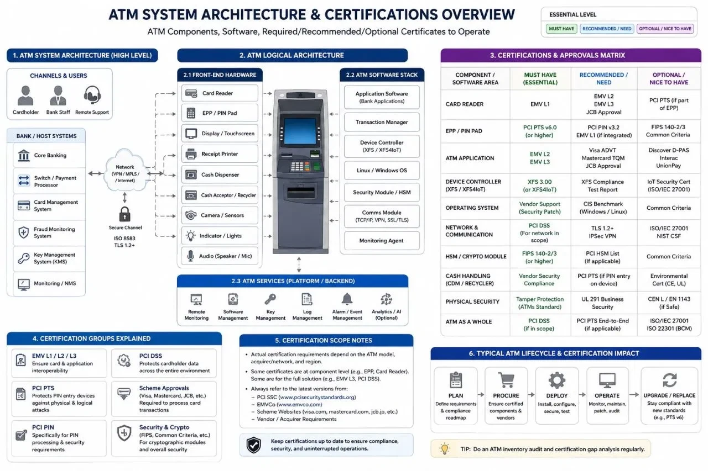

# ATM Simülatörü

NCR SelfServ 84 (6684) benzeri bir ATM'nin önden görünümünü ve işlemlerin arka planda
bankanın sistemlerinde nasıl ilerlediğini görsel olarak gösteren simülatör.

- **Ön yüz:** React (Vite). ATM ekranı, EPP tuş takımı, kart okuyucu, para çıkışı/girişi, fiş yazıcı.
- **Arka uç:** Python (Flask), Vercel Serverless Function olarak çalışır. ATM Switch → InterAPI → HSM / Fraud / Core Banking / Fatura Kurumu ve başka banka kartları için BKM rotasını simüle eder.

## Ekran görüntüleri

**İşlem sürerken:** InterAPI → Core Banking adımı mesaj akışında canlandırılıyor.



**Para çekme tamamlandı:** fiş yazdırıldı, kaset ve hesap bakiyesi güncellendi, olay günlüğünde XFS komutları görünüyor.



**Mobil görünüm:**



## Neler görülebiliyor?

| İşlem | Cihaz (XFS) olayları | Host tarafı |
|---|---|---|
| Kart takma | `IDC_READ_RAW_DATA`, `IDC_CHIP_IO` | Kart bilgisi |
| PIN | `PIN_GET_PIN`, `PIN_GET_PINBLOCK` | ISO 8583 `0100/0110`, HSM doğrulama, 3 hatalı denemede kart alıkonur |
| Para çekme | `CDM_DENOMINATE`, `CDM_DISPENSE`, `IDC_EJECT_CARD`, `CDM_PRESENT` | `0200/0210`, fraud kontrolü, bakiye, günlük limit, kaset planı (geri izlemeli) |
| Para yatırma | `CIM_CASH_IN_START/CASH_IN/CASH_IN_END` | Recycler'a geri dönüşüm, şüpheli banknot alıkoyma |
| Bakiye | – | `0100/0110`, alan 54 |
| Fatura ödeme | – | Kurum sorgu + tahsilat |
| Çek yatırma | `IPM_MEDIA_IN`, `IPM_READ_IMAGE` | MICR satırı, takas durumu |

Sağ paneldeki **Mesaj akışı** diyagramı her isteğin hangi sistemlerden geçtiğini adım adım canlandırır;
**Olay günlüğü** XFS komutlarını ve ISO 8583 alanlarını (2, 3, 4, 11, 37, 38, 39, 41, 49, 52, 54) gösterir.

### Demo kartlar

| Kart | PIN | Not |
|---|---|---|
| VISA 4543 … 0001 | 1234 | Kendi kartı, yüksek bakiye |
| TROY 9792 … 0042 | 4321 | Kendi kartı, düşük bakiye (51 yetersiz bakiye denemek için) |
| MASTERCARD 5170 … 7788 | 0000 | Başka banka kartı, BKM rotası |

20 TL kaseti bilerek az doldurulmuştur; 60, 70 gibi tutarlarda kaset planlamasını izleyebilirsiniz.

## Yerelde çalıştırma

```bash
npm install
pip install -r requirements-dev.txt

# 1. terminal: Python host simülatörü (http://localhost:5328)
npm run dev:api

# 2. terminal: React arayüzü (http://localhost:5173, /api istekleri 5328'e proxy'lenir)
npm run dev
```

Alternatif olarak Vercel CLI ile ikisini birlikte çalıştırabilirsiniz: `vercel dev`

Testler: `pytest -q`

## Vercel'e yayınlama (Git entegrasyonu)

1. Bu klasörü GitHub/GitLab'da yeni bir repoya push edin:
   ```bash
   git remote add origin git@github.com:<kullanici>/atm-simulator.git
   git push -u origin main
   ```
2. Vercel'de **Add New → Project** ile repoyu seçin. `vercel.json` ayarları otomatik okunur:
   - Framework: Vite, build `npm run build`, çıktı `dist`
   - `api/index.py` Python fonksiyonu olarak derlenir, `requirements.txt` kurulur
   - `/api/*` istekleri `api/index` fonksiyonuna yönlenir
3. **Settings → Environment Variables** altına `SESSION_SECRET` ekleyin (uzun, rastgele bir değer).
4. Sonrasında `main`'e her push production'a, her pull request ayrı bir preview URL'ine deploy edilir.
   `.github/workflows/ci.yml` aynı anda Python testlerini ve React build'ini çalıştırır.

## Mimari notlar

### Gerçek ATM mimarisi ve sertifikasyonlar

Simülatörün modellediği yapının gerçek dünyadaki karşılığı: ATM donanımı ve yazılım katmanları,
banka/host sistemleri, bileşen bazında gerekli sertifikalar (EMV, PCI PTS, PCI DSS, XFS vb.) ve
ATM yaşam döngüsü.



### Bu projede

- Vercel fonksiyonları durumsuzdur. Bu yüzden hesap bakiyeleri ve kaset sayıları tarayıcıda tutulur,
  her istekte hosta gönderilir; host kuralları uygular ve yeni durumu döner. Gerçek sistemde bu
  veriler core banking veritabanında ve ATM'nin kendi kaset sayaçlarında tutulur.
- PIN'ler sunucuda yalnızca hash olarak bulunur. PIN doğrulandıktan sonra HMAC ile imzalı,
  5 dakika geçerli bir oturum token'ı verilir; diğer tüm işlemler bu token'ı ister.
- Bu proje eğitim amaçlıdır; gerçek bir banka, kart şeması veya kurumla bağlantısı yoktur.

```
api/
  index.py        Flask uygulaması, tüm /api rotaları
  _host.py        Host iş kuralları (alt çizgi: Vercel bunu ayrı fonksiyon yapmaz)
src/
  App.jsx         İşlem akışı / durum makinesi
  components/     AtmMachine, Screen, FlowDiagram, EventLog, StatusPanel, Wallet
tests/            pytest testleri
vercel.json       Build, Python fonksiyonu ve rewrite ayarları
```
